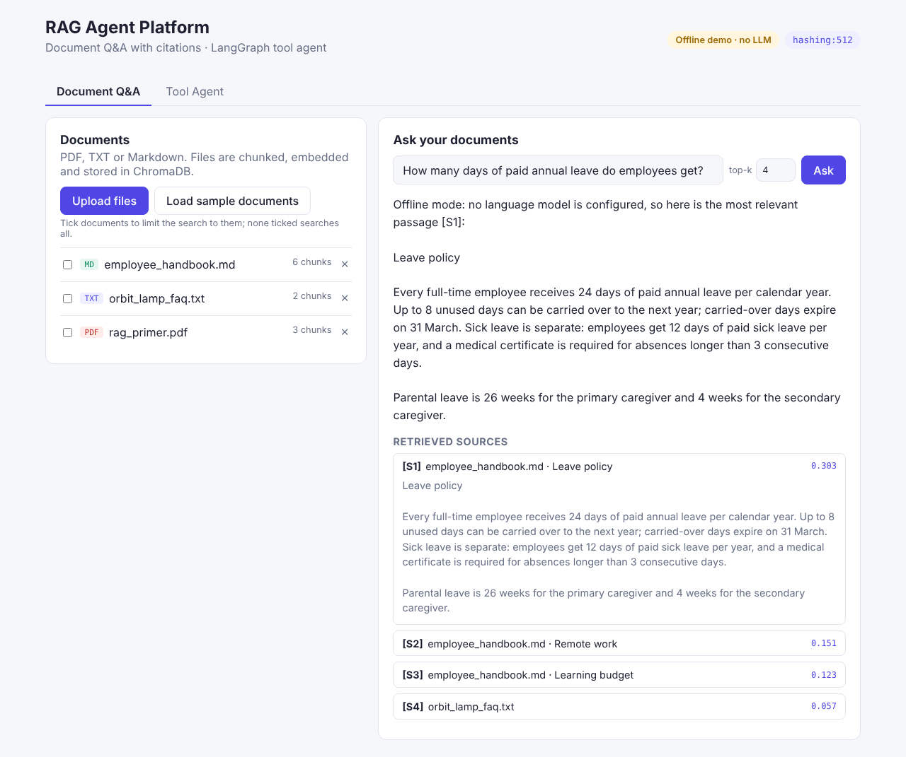
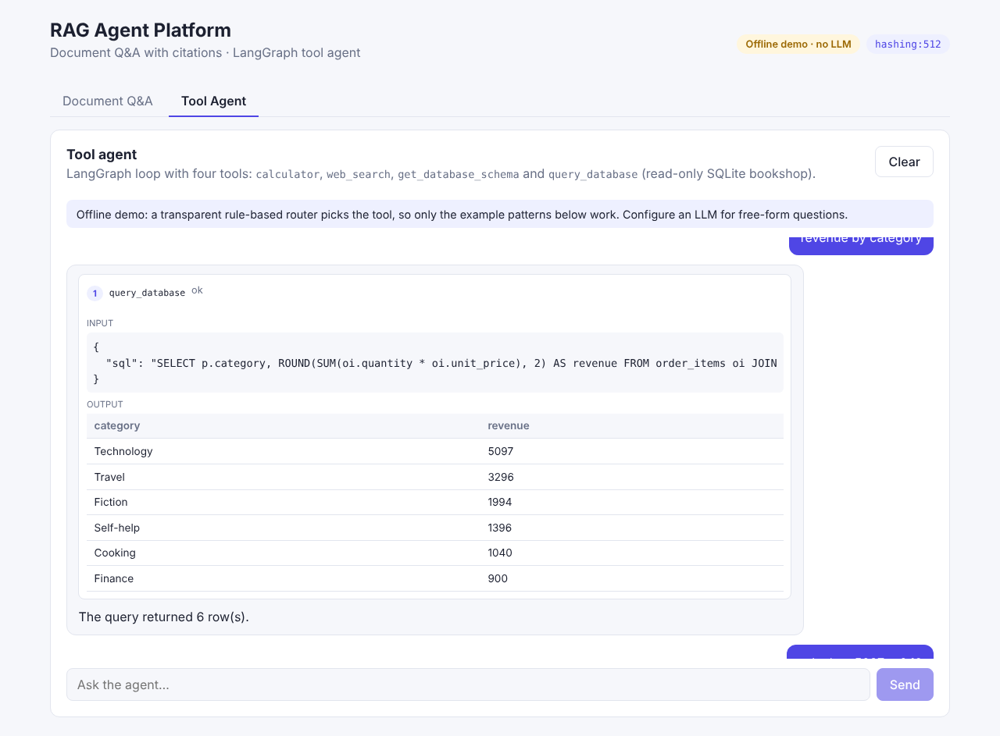

# RAG Agent Platform · Document Q&A + Tool Agent

A personal project by **Angad Kumar**: ask questions about your own PDF, TXT and Markdown files
with cited answers, or hand a task to a LangGraph agent that can search the web, calculate and
query a database.

**Try it without an API key.** The offline demo includes sample documents, real embeddings and
retrieval, and the real LangGraph agent graph with a transparent rule-based planner. Optional
OpenAI or Anthropic mode adds generated, cited answers and free-form tool use.

This repository contains an independent portfolio application with fictional sample data. It
does not contain employer source code or customer data, and it makes no claims about production
performance.

| Document Q&A | Tool agent |
|---|---|
|  |  |

## Start here

Use Python 3.12 and Node 22. The first run needs internet access to install packages and to
download the embedding model (~90 MB) from Hugging Face.

From this repository's root folder:

```bash
python -m venv .venv
```

Activate the environment:

* macOS / Linux: `source .venv/bin/activate`
* Windows PowerShell: `.venv\Scripts\Activate.ps1`
* Windows Command Prompt: `.venv\Scripts\activate.bat`

Then:

```bash
# CPU-only PyTorch first: a much smaller download than the default GPU build
python -m pip install torch --index-url https://download.pytorch.org/whl/cpu
python -m pip install -e .

cd frontend && npm ci && npm run build && cd ..
python -m rag_agent_platform
```

Open <http://127.0.0.1:8000>. No Docker, database server, account or API key is needed for the
demo. If the port is busy, run with `--port 8001` and open the matching address.

For UI development with hot reload, keep the API running and start `npm run dev` in `frontend/`,
then open <http://localhost:5173>.

## A two-minute walkthrough

1. On **Document Q&A**, click **Load sample documents**: a fictional employee handbook (Markdown),
   a product FAQ (TXT) and a three-page RAG primer (PDF).
2. Ask *How many days of paid annual leave do employees get?* Open source **[S1]**: it shows the
   file, the Markdown section and the similarity score.
3. Ask a question about the RAG primer, such as *What does chunk overlap prevent?* Its sources
   show the PDF **page** number.
4. Tick one document and ask again: retrieval is limited to the ticked files.
5. Upload your own file. Uploading the same file twice is detected and not indexed again.
6. Open **Tool Agent** and click **revenue by category**: the step card shows the SQL and the
   result table.
7. Try `calculate (1250 * 18) / 100`, then `sql: DELETE FROM orders` to see the read-only
   database refuse the write.

## What is implemented

| Feature | Implementation |
|---|---|
| Document loading | PDF per page (pypdf), Markdown per heading, UTF-8 text; clear errors for scanned or encrypted PDFs |
| Chunking | Recursive paragraph → sentence → word splitting, configurable size and overlap |
| Embeddings | Hugging Face `sentence-transformers/all-MiniLM-L6-v2`, local CPU, normalised vectors |
| Vector store | ChromaDB persistent collection, cosine similarity, top-k retrieval with optional document filter |
| Grounded answers | Numbered sources `[S1]…`; unknown or missing citations are flagged as warnings |
| Tool agent | LangGraph `StateGraph` planner ⇄ `ToolNode` loop with a step limit |
| Tools | Safe AST calculator, DuckDuckGo web search, schema lookup, read-only SQLite queries |
| Database safety | `mode=ro` connection, SQLite authorizer, single-statement check, row and time limits |
| Model adapters | OpenAI and Anthropic through LangChain chat models with tool calling |
| Failure handling | Provider errors, tool errors and step-limit overruns are reported explicitly |
| Backend | FastAPI with typed request/response models; serves the built UI |
| UI | React + TypeScript (Vite): uploads, document list, cited answers, agent chat with tool-step cards |
| Packaging | Dockerfile (multi-stage, CPU PyTorch), Docker Compose, GitHub Actions CI |

Details and diagrams: [docs/ARCHITECTURE.md](docs/ARCHITECTURE.md).

## Offline and live behaviour

| Operation | Offline demo | Live model mode |
|---|---|---|
| Embeddings and retrieval | Hugging Face + ChromaDB | Hugging Face + ChromaDB |
| Q&A answer | Most relevant retrieved passage | Model answer grounded in retrieved chunks, with citations |
| Agent planning | Rule-based router (patterns below) | Model chooses and chains tools freely |
| Tool execution | Real tools | Real tools |
| Network | Web search only (optional) | Model provider + web search |

Supported offline agent inputs:

* `calculate (1250 * 18) / 100`, `sqrt(144) + 2^5`
* `revenue by category`, `top customers`, `orders by status`, `best selling books`
* `show database schema`
* `sql: SELECT city, COUNT(*) FROM customers GROUP BY city`
* `search: LangGraph documentation`

Anything else returns a clear limitation. It is not silently approximated.

## Optional live AI

Copy `.env.example` to `.env` in the folder where you run the app and set:

```
RAG_PROVIDER=openai
RAG_MODEL=YOUR_SUPPORTED_MODEL_ID
RAG_API_KEY=YOUR_API_KEY
```

For Anthropic, set the provider to `anthropic` and use an appropriate model ID and key. Use a model
that supports tool calling. Restart the app after changing the configuration.

Live mode sends your question, the retrieved chunks and agent messages to the chosen provider and
can incur API charges. Keys stay on the backend. There are no automatic paid retries and no silent
fallback to offline mode.

## Development and checks

```bash
python -m pip install -e ".[dev]"
python -m pytest -q
python -m ruff check .
python scripts/smoke.py
python -m build --wheel

cd frontend
npm test
npm run build
```

Tests and the smoke script use `RAG_EMBEDDINGS=hashing`, a deterministic lexical embedder, so they
run without downloading a model. A GitHub Actions workflow runs lint, tests, the smoke test, the
wheel build and the UI tests and build on every push. See
[docs/VERIFICATION.md](docs/VERIFICATION.md) for exactly what was and was not verified.

## Data and scope

* Data is stored in `.ragdata/` under the launch directory (ChromaDB in `.ragdata/chroma`, the
  sample bookshop database in `.ragdata/sample_store.sqlite3`). Set `RAG_DATA_DIR` to change it.
* Switching embedding models with existing data is refused; delete `.ragdata/chroma` and
  re-upload.
* Uploads are limited to 10 MB per file (`RAG_MAX_UPLOAD_MB`). There is no OCR for scanned PDFs.
* There is no authentication. Keep the app on your own machine; the Docker port mapping is
  loopback-only.

## Docker

```bash
docker compose up --build
```

Then open <http://127.0.0.1:8000>. Data and the model cache persist in the `ragdata` volume.
Docker was not available for validation when this revision was written; the Python quickstart is
the verified path.

## Portfolio wording

**RAG Agent Platform: independent personal project**
Built a dual-mode GenAI application: document Q&A over PDF, TXT and Markdown using chunking,
Hugging Face embeddings, ChromaDB and top-k retrieval, plus a LangGraph tool agent for web
search, calculations and database queries. FastAPI backend, React UI, Docker.

Do not present the offline rule-based planner as a live LLM demonstration. When recording a demo,
show the mode badge and say whether a model is configured.
