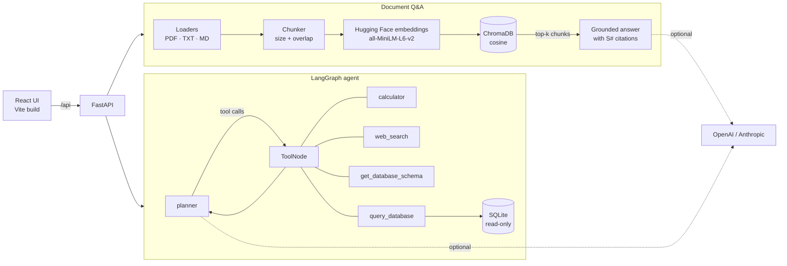

# Architecture

One FastAPI process hosts the API and the built React UI. It has two independent modes that share
the same chat-model configuration.



## Document Q&A

| Step | File | Notes |
|---|---|---|
| Load | `rag/loaders.py` | PDF per page (pypdf), Markdown per heading, TXT whole. UTF-8 only. Scanned PDFs are rejected with a clear message (no OCR). |
| Chunk | `rag/chunking.py` | Recursive: paragraphs → sentences → words. Default 800 characters with 120 overlap. |
| Embed | `rag/embeddings.py` | `sentence-transformers/all-MiniLM-L6-v2` on CPU, normalised vectors. A hashing embedder exists only for tests and CI. |
| Store | `rag/store.py` | ChromaDB persistent collection, cosine space. We pass our own vectors, so Chroma never downloads its default model. The embedder name is stored on the collection; switching embedders with existing data is refused, because vectors from different models are not comparable. |
| Retrieve | `rag/service.py` | Top-k by cosine similarity, optionally filtered to selected documents. |
| Answer | `rag/service.py` | Live mode: the model sees numbered sources `[S1]…[Sk]`, must cite them and must say when the answer is not in the sources. Citations to sources that do not exist, and uncited answers, are returned as warnings. Offline mode returns the best passage instead of generating text. |

Documents are identified by the SHA-256 of their bytes, so uploading the same file twice does not
create duplicate chunks.

## Tool agent

`agent/graph.py` builds a `StateGraph(MessagesState)`:

```
START → planner ──(tool calls?)──▶ tools ──▶ planner … ──▶ END
```

* **Live mode:** the planner is the chat model with the four tools bound (`bind_tools`). This is a
  standard ReAct loop; the model can chain several tools (for example schema → SQL → calculator).
* **Offline mode:** the planner is a transparent rule-based router (`agent/offline.py`). It emits
  the same tool-call messages a model would, so the graph, `ToolNode` and API response are
  identical. Unsupported requests get an explicit limitation message rather than a guess.
* The loop is capped by `RAG_AGENT_MAX_STEPS` through LangGraph's recursion limit.
* Tool errors become `ToolMessage`s with `status="error"`, so the model can correct itself and the
  UI can show the failure.

### Tool safety

| Tool | Safeguards |
|---|---|
| `calculator` | AST whitelist: numbers, arithmetic operators, a fixed list of maths functions. No names, attributes or arbitrary calls. Exponent and length limits. |
| `query_database` | Single statement only; must start with `SELECT`/`WITH`; database opened with `mode=ro`; SQLite authorizer allows only read actions (no `PRAGMA`, `ATTACH`, writes or `load_extension`); progress handler aborts runaway queries; at most 50 rows returned. |
| `web_search` | DuckDuckGo via `ddgs`, no key. Can be disabled with `RAG_WEB_SEARCH=false`. Failures are reported, not hidden. |

## API

| Method | Path | Purpose |
|---|---|---|
| GET | `/api/health` | Mode, provider, embedder, counts |
| GET | `/api/documents` | Indexed documents |
| POST | `/api/documents` | Upload one or more files (multipart field `files`) |
| POST | `/api/documents/samples` | Index the files in `sample_docs/` |
| DELETE | `/api/documents/{doc_id}` | Remove a document and its chunks |
| POST | `/api/qa` | `{question, top_k?, doc_ids?}` → answer, sources, warnings |
| POST | `/api/agent` | `{message, history?}` → answer and tool steps |

Interactive docs: `http://127.0.0.1:8000/docs`.

Example:

```bash
curl -s localhost:8000/api/qa -H 'Content-Type: application/json' \
  -d '{"question": "How long is parental leave?", "top_k": 3}'
```

## Design decisions

* **No silent fallbacks.** If the embedding model cannot load, or a provider call fails, the API
  returns an explicit error. Offline mode is a visible, deliberate mode, never a hidden fallback.
* **The model never writes data.** The agent's database is read-only at the connection level, not
  only by prompt instructions.
* **Same graph in both modes.** Offline mode replaces only the planner node, so the demo exercises
  the real LangGraph wiring and tool execution.
* **Single process.** FastAPI serves the built UI, so one port and one container run everything.
